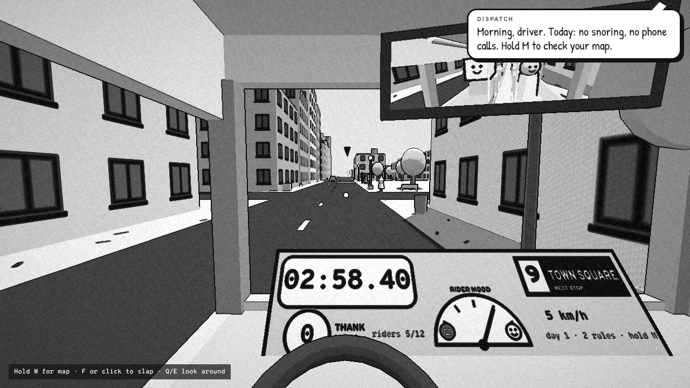
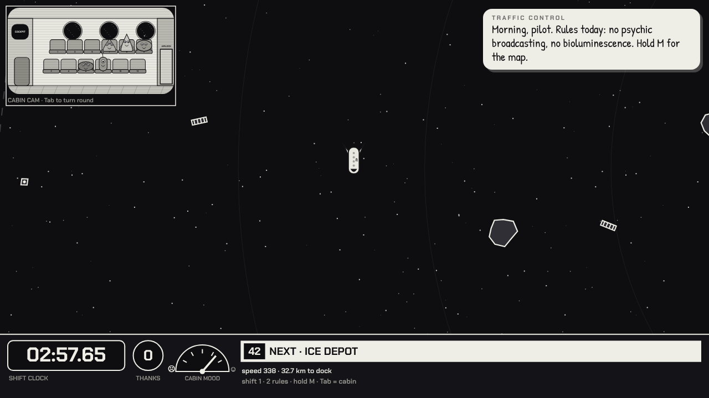
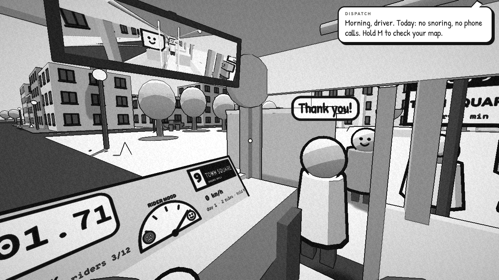
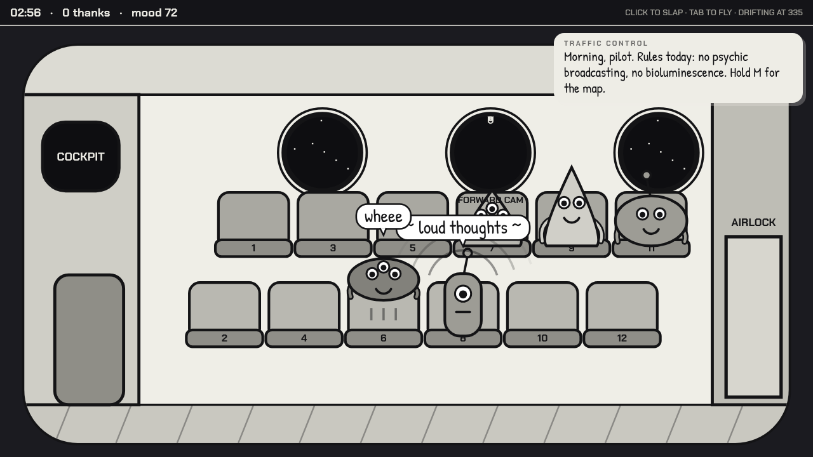
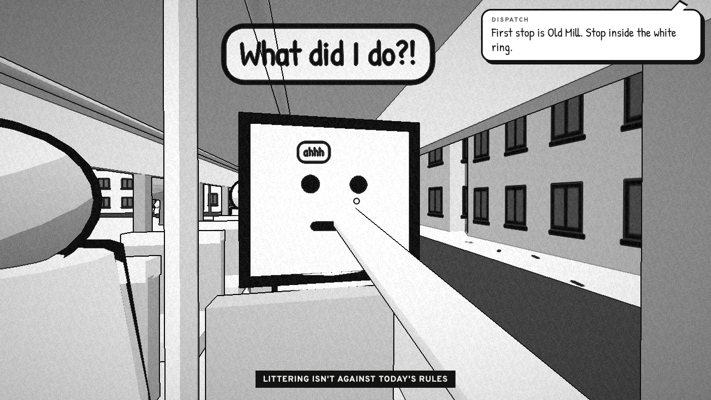
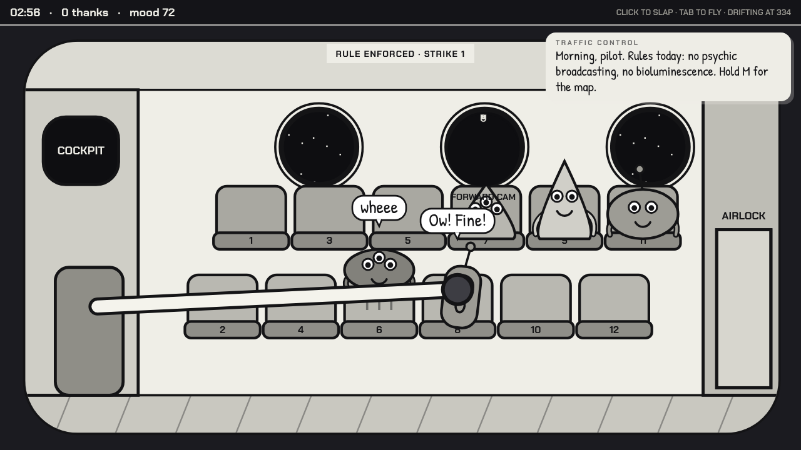
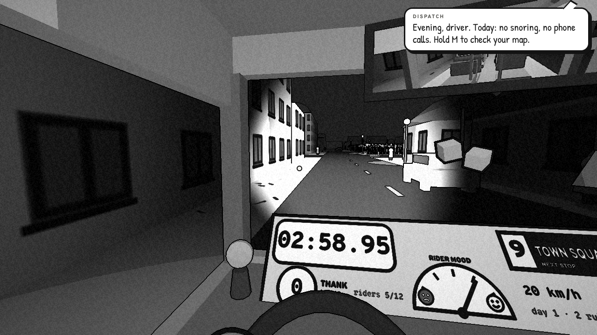
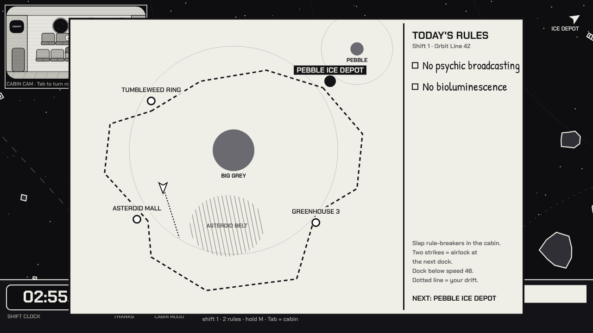

# Two greybox game slices, built by Claude Code

[](https://github.com/micspam/vigilant-garbanzo/actions/workflows/ci.yml)

**Play them:** [Route 9](https://micspam.github.io/vigilant-garbanzo/route-9/) (3D bus) · [Orbit Line 42](https://micspam.github.io/vigilant-garbanzo/orbit-line/) (2D space) · [both](https://micspam.github.io/vigilant-garbanzo/)

Keyboard and mouse recommended. Both run in the browser with nothing to install.

## What this is

A test of one claim: that AI coding is impossible without heavy hand-holding.

Claude (Anthropic's model, running in Claude Code) was shown the public itch.io store page for [*Thank You Bus Driver*](https://doublefine.itch.io/thank-you-bus-driver), a chaotic first-person bus game from Double Fine Productions. The page has three bullet points and ten screenshots. It was asked whether it could rebuild the game's design from that page alone, without downloading the game. It said yes, wrote a design breakdown, and was then told to build a greybox vertical slice. That's **Route 9**.

It was then asked for a "spiritual clone set in space, 2D is fine". It recommended a design and asked one question about it. The human said they wouldn't answer and told it to do what it thought best. That's **Orbit Line 42**.

Everything in this repo was written by Claude: both games, the tests, the CI, the landing page and these documents. [SELF_REVIEW.md](SELF_REVIEW.md) is Claude's own critical code review.

| | Route 9 | Orbit Line 42 |
|---|---|---|
| Type | 3D first person (Three.js r128) | 2D canvas, no libraries |
| Source | `route-9/index.html`, ~1,520 lines | `orbit-line/index.html`, ~1,060 lines |
| Human direction | ~60 words across two messages | ~120 words across two messages |
| Human code edits | 0 | 0 |
| Human bug reports | 0 | 0 |

## Screenshots

| Route 9 | Orbit Line 42 |
|---|---|
|  |  |
|  |  |
|  |  |
|  |  |

## How it was built

1. **Read the source material.** Claude fetched the store page and all ten screenshots and wrote a breakdown of what each one shows: a dashboard timer, a "thank you" counter, a mood dial, a map that covers the windscreen, a stretchy slapping arm, rules announced over a speaker, cosmetic unlocks. It also listed what the page couldn't answer.
2. **Built it.** Single-file HTML games, written from scratch.
3. **Tested it in a headless browser.** An autopilot drives each game through its whole route, scripted checks exercise every rule path, and screenshots were taken of every scene and at phone width.
4. **Looked at the screenshots and fixed what was wrong.** See the bug list below.
5. **Published** as private artifacts, then packaged into this repo with CI.

### Bugs Claude found and fixed itself, with no human reports

- The camera wasn't attached to the bus, so the first render came from the town centre with no bus in it.
- Chrome's pointer-lock produced a huge mouse-movement spike that spun the camera on start.
- The dashboard covered half the windscreen, and the timer digits overflowed their box.
- The rear-view mirror's frame was misaligned and showed as a black slab.
- The corn looked like spikes, then like funnels, before it looked like corn.
- The night variant wasn't dark: the lights were too strong for the toon shading.
- On phones, the touch controls covered the dashboard and the dispatch bubble covered the cabin text.
- One of its own tests measured passenger mood at the wrong moment, after docking had legitimately raised it, so the test failed intermittently. The game was fine; the test was wrong.

## Tests

```bash
npm ci
npx playwright install chromium
npx playwright test
```

There are ten Playwright tests across both games. They run on every push, and screenshots from each CI run are uploaded as a build artifact.

- **Autopilot runs.** Route 9 drives the whole route, including through the cornfield, and serves every stop. Orbit Line flies the whole route under inertia and planetary gravity, and docks at all four stations.
- **Rules.** A fair slap gives a strike, two strikes gets a passenger thrown out at the next stop (Orbit Line: the airlock), and an unfair slap costs mood.
- **Edge cases.** Leaving a stop with the doors still open; title screens; phone-width layouts. Every test also fails on any console error.

## Honest limits

- **Nobody has playtested these by hand.** Handling, docking speed and mood numbers are first guesses that pass automated checks. Whether they feel good needs a human playing.
- **They are small, new, self-contained projects,** which is where AI coding works best. Large existing codebases are harder.
- **The mechanics are deliberately borrowed** from [*Thank You Bus Driver*](https://doublefine.itch.io/thank-you-bus-driver); that was the point. The code, art, names and writing are original, and no files or assets from that game were used.
- **The code quality has real problems.** See [SELF_REVIEW.md](SELF_REVIEW.md).

## FAQ for sceptics

**A human must have fixed the bugs.**
See the bug list above and the commit history. The human reported no bugs and edited no code.

**The AI wrote its own tests, so they prove nothing.**
They're short and readable, so read them, or skip them and play the games. CI screenshots from every run are attached to the Actions results.

**It's just a clone.**
The mechanics are borrowed on purpose. Game mechanics aren't copyrightable, and nothing here copies the original's art, characters, names or code. Orbit Line moves the idea to a new setting, with a new view model, physics and rules. If you like the idea, [go and buy the real one](https://doublefine.itch.io/thank-you-bus-driver). It's $4.99, and it has the art, writing and polish a greybox doesn't.

**These are toys.**
Yes. The claim being tested was "impossible without aggressive hand-holding", not "replaces a studio".

**How many tokens did it take?**
Token use isn't metered per task, so there's no exact figure. The final source files are roughly 50k output tokens. Total billed usage is much higher, because each step re-reads the conversation. A rough figure for the actual work is a few hundred thousand tokens.

**The code is a mess.**
Some of it, yes. [SELF_REVIEW.md](SELF_REVIEW.md) lists eighteen problems, numbered, so a review can reference them.

## Open challenge

Find a gameplay bug the tests don't catch and [open an issue](https://github.com/micspam/vigilant-garbanzo/issues/new) with steps to reproduce it. The plan is to hand each valid issue to Claude to fix, with the fix linked back to the issue.

## Credits and legal

Original code by Claude (Anthropic) via Claude Code, directed briefly by the repo owner.

The idea and core mechanics come from [*Thank You Bus Driver*](https://doublefine.itch.io/thank-you-bus-driver) by Double Fine Productions, published under Double Fine Action Labs, as described on its public itch.io store page. This project is not affiliated with or endorsed by Double Fine, and was not built from the game's files or assets. If you enjoyed these slices, please support the original.

Route 9 uses [Three.js](https://threejs.org/) (MIT). Fonts from Google Fonts.
